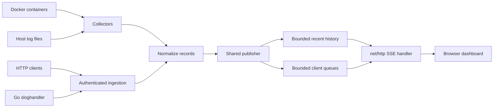

# Architecture and Data Flow

LogStreamer is a standalone Go service. Configured Docker containers, Docker Compose services, host files, and HTTP clients feed one normalized log pipeline. The service retains a bounded in-memory history and streams matching events to browsers over Server-Sent Events (SSE). It does not persist log history or require a database or message broker.

Configured source names are the authoritative identity used for filtering and display. JSON records retain common fields and extra attributes; recognizable plain-text levels are normalized, with unknown levels classified as `UNKNOWN`.

The shared publisher isolates producers from slow browsers using a bounded queue per client. New subscribers atomically register and receive a chronological recent snapshot followed by live events. A client that exceeds its queue capacity is disconnected. History is process-local and is lost when the process stops.

The service exposes `/`, `/api/logs/stream`, `/api/services`, and `/healthz`. Stream filters use the `source`, `level`, and `origin` query parameters. Docker and Compose collectors follow only configured names or standard project/service labels; file collectors start at EOF and detect truncation and replacement. Docker, Compose, and file records enter the shared publisher alongside authenticated HTTP ingestion.

HTTP ingestion uses `POST /api/logs?source=<configured-http-source>` with a bearer token from `LOGSTREAMER_INGEST_TOKEN`. The body is one JSON event or a nonempty array. Each event must contain a string `message` or `msg`; `timestamp`, `level`, `fields`, and additional metadata are optional. The configured query source determines event identity, regardless of body metadata. The server validates the entire batch before publishing and returns `202` with an accepted count. Body, batch, and per-event sizes are bounded by configuration.

`/api/services` exposes configured source names, types, states, and generic safe error summaries. Collectors report `starting`, `running`, `retrying`, or `stopped`; HTTP sources are `running` when ingestion is available. Compose discovery reconciles every five seconds, and file sources poll every 250 ms. Docker and Compose start at the live edge; reconnects can produce duplicates around stream boundaries. History and SSE sequence IDs remain process-local.

The embedded dashboard filters by source and level in the browser, so changing controls does not reconnect SSE. Its pause, auto-scroll, and clear controls affect only a bounded 500-event browser buffer. The public `sloghandler` package delegates records to a supplied handler and forwards a bounded asynchronous copy to HTTP ingestion; a full queue or failed request drops only the forwarded copy.
