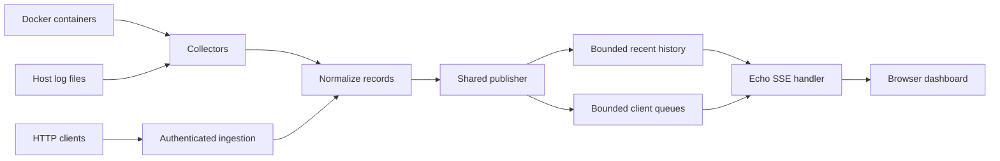

# Architecture and Data Flow

LogStreamer is planned as a standalone Go service. Configured Docker containers, Docker Compose services, host files, and HTTP clients will feed one normalized log pipeline. The service will retain a bounded in-memory history and stream matching events to browsers over Server-Sent Events (SSE). It will not persist log history or require a database or message broker.

Configured source names are the authoritative identity used for filtering and display. JSON records retain common fields and extra attributes; recognizable plain-text levels are normalized, with unknown levels classified as `UNKNOWN`.

The shared publisher isolates collectors from slow browsers using a bounded queue per client. New subscribers receive a chronological recent snapshot followed by live events. A client that exceeds its queue capacity is disconnected. History is process-local and is lost when the process stops.

The HTTP server and handlers will use Echo. Phase 1 only establishes configuration; collectors, the Echo server, HTTP ingestion, SSE delivery, and dashboard behavior are implemented in later phases.
