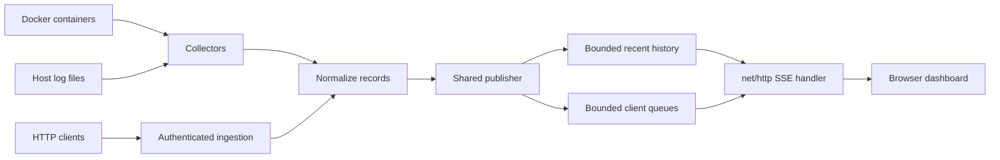

# Architecture and Data Flow

LogStreamer is a standalone Go service. Configured Docker containers, Docker Compose services, host files, and HTTP clients will feed one normalized log pipeline as their collectors are added. The service retains a bounded in-memory history and streams matching events to browsers over Server-Sent Events (SSE). It does not persist log history or require a database or message broker.

Configured source names are the authoritative identity used for filtering and display. JSON records retain common fields and extra attributes; recognizable plain-text levels are normalized, with unknown levels classified as `UNKNOWN`.

The shared publisher isolates producers from slow browsers using a bounded queue per client. New subscribers atomically register and receive a chronological recent snapshot followed by live events. A client that exceeds its queue capacity is disconnected. History is process-local and is lost when the process stops.

Phase 2 implements the common event parser, bounded publisher, `net/http` server, SSE endpoint, source and health endpoints, and a minimal dashboard. The routes are `/`, `/api/logs/stream`, `/api/services`, and `/healthz`. Stream filters use the `source`, `level`, and `origin` query parameters. Configured sources report `configured` until collectors are implemented in Phase 3. HTTP ingestion, Docker and file collectors, and the completed dashboard remain later-phase work.
